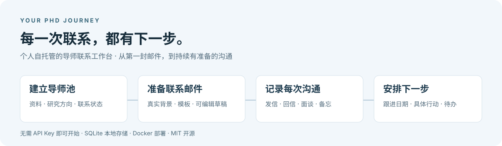

# AutoSocial

**A personal workspace for PhD supervisor outreach — from the first email to the next follow-up.**

Keep supervisor profiles, communication history, next actions, and follow-up dates together. Designed for applicants who want a clearer picture of whom to contact and what to do next.



- Track upcoming, due-today, and overdue follow-ups.
- Record sent emails, replies, meetings, and notes in a timeline.
- Maintain a searchable supervisor pool with stages and CSV export.
- Write editable drafts from your own background and template.
- Optionally connect search, an LLM, SMTP, and IMAP.
- Self-host one personal instance with SQLite and password protection.

**No API key is required for manual tracking or template drafts.** The current interface is in Chinese. Each instance has one shared workspace; multi-user accounts and background notifications are not included.

## Quick start

Replace `<REPOSITORY_URL>` with the repository you want to clone.

```bash
git clone <REPOSITORY_URL> Autosocial
cd Autosocial
cp .env.example .env
```

Set `AUTOSOCIAL_PASSWORD` in `.env` to your own password of at least 12 characters, then:

```bash
docker compose up -d --build
```

Open http://127.0.0.1:8000 and log in with `autosocial` and your password. First launch creates the required database and templates. Data lives in a persistent Docker volume. Use HTTPS before exposing an instance publicly.

To explore an **empty instance** with five fictional mentors:

```bash
docker compose exec autosocial python /app/scripts/seed_demo.py
```

The script refuses to modify a database that already has mentors and never sends email.

See the [Chinese README](README.md) for local setup and configuration, [deployment guide](DEPLOY.md) for backup and migration, and [contribution guide](CONTRIBUTING.md) for development and tests. Search and AI output require human verification. When enabled, external model services receive the profile and supervisor information needed to generate a draft.

## License

[MIT](LICENSE).
