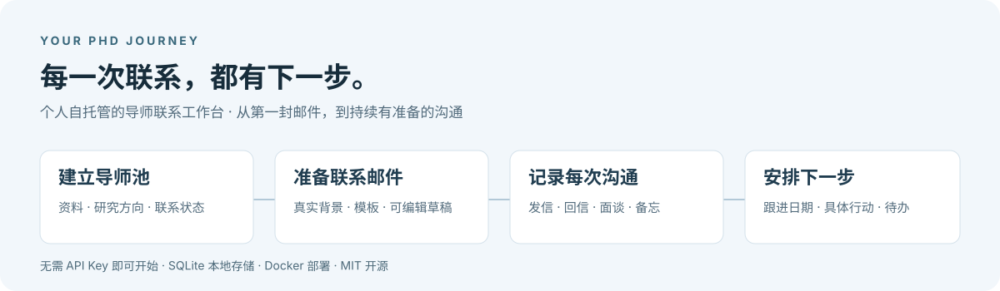

<div align="center">

# AutoSocial

### 从第一封联系邮件，到每一次有准备的跟进。

给博士申请者的个人导师联系工作台。把导师资料、沟通记录、下一步行动和跟进日期放在一起。

**自己部署 · 自己保管数据 · 无需 API Key 即可开始**

[快速开始](#快速开始) · [使用流程](#使用流程) · [部署与备份](DEPLOY.md) · [参与贡献](CONTRIBUTING.md) · [English](README.en.md)

</div>



## 申请季里，最难维护的往往是下一步

你可能已经有一张导师表、一堆浏览器标签，还有散落在邮箱里的沟通记录。过了两周，很难立刻回答：谁还没回复？哪位老师让你补研究计划？今天该跟进谁？

AutoSocial 把这些信息整理为一个可以每天打开、持续维护的工作台：**每位导师有进度，每次交流有记录，每个下一步有日期。**

## 使用流程

1. **建立导师池**：手动添加导师姓名、学校、主页、研究方向和邮箱；也可以按目标学校检索，再人工核实。
2. **准备第一封邮件**：在设置中填写个人背景和模板，生成可编辑草稿。无需模型也能按模板写信，配置模型后可辅助润色。
3. **记录实际沟通**：在时间线记录已发邮件、导师回复、面谈或普通备注。用自己的邮箱发信后，同样可以手动记录。
4. **安排下一步**：填写“补充研究计划”“阅读论文”等行动与日期，从工作台查看逾期、今天和即将到来的跟进。
5. **保持可迁移**：导师池可导出 CSV，完整数据可备份，迁移部署时仍由你掌握。

| 能力 | 不配置外部服务 | 按需配置后 |
| --- | --- | --- |
| 导师资料、状态、标签与搜索 | 可用 | — |
| 跟进日期、下一步、沟通时间线 | 可用 | — |
| 模板草稿、编辑与复制 | 可用 | 模型辅助生成研究切入点 |
| 导师发现 | 官网目录抓取，需要联网 | 搜索服务、混合检索 |
| 邮件沟通 | 使用自己的邮箱并手动记录 | SMTP 发送、IMAP 回信同步 API / CLI |

当前定位为**单人自托管工具**，一个实例共用一套数据。跟进提醒显示在工作台中，尚不包含后台推送、定时催信或多人账户。

## 快速开始

### Docker（推荐）

准备 Docker Engine / Desktop 和 Compose，将 `<REPOSITORY_URL>` 替换为你要克隆的仓库地址，然后：

```bash
git clone <REPOSITORY_URL> Autosocial
cd Autosocial
cp .env.example .env
```

在 `.env` 中设置一个至少 12 个字符的独立密码：

```dotenv
AUTOSOCIAL_USERNAME=autosocial
AUTOSOCIAL_PASSWORD=请替换为你自己的长密码
```

启动：

```bash
docker compose up -d --build
```

打开 **http://127.0.0.1:8000**，在浏览器登录框中输入用户名和密码。首次启动会创建数据库、空白个人画像和邮件模板，无需提前填写 AI 或邮箱密钥。

所有申请数据保存在 `autosocial-data` 命名卷中，更新镜像不会清空数据。不要用 `docker compose down -v` 更新，它会删除卷。公网部署请使用 HTTPS，参见 [部署指南](DEPLOY.md)。

### 本地运行

需要 Python **3.11+**、Node.js **22+**。以下命令在项目根目录执行：

```bash
python3 -m venv .venv
source .venv/bin/activate
# Windows PowerShell: .\.venv\Scripts\Activate.ps1
pip install -r requirements.txt
cp .env.example .env
python -m autosocial init-db
cd frontend
npm ci
npm run build
cd ..
python -m uvicorn server.main:app --host 127.0.0.1 --port 8000
```

Windows 可用 `Copy-Item .env.example .env` 复制配置。只在自己电脑上体验时可暂不填密码，并保持 `127.0.0.1` 监听；访问保护和公网部署要求见 [DEPLOY.md](DEPLOY.md)。

首次进入后，直接添加导师即可管理进度。需要写信时，再到“设置”补充真实个人背景与模板。

### 想先看看效果？

在**空数据库**中运行：

```bash
python scripts/seed_demo.py
# Docker:
# docker compose exec autosocial python /app/scripts/seed_demo.py
```

这会添加 5 位虚构导师及跟进记录，不发送邮件。已有导师数据时脚本会拒绝执行。可用这组演示数据体验工作流，或录制自己的产品演示。

## 配置按需开启

基础跟进流程不依赖 AI 或邮箱。可选配置都在 [.env.example](.env.example)：

- `LLM_*`：兼容 Chat Completions 的模型接口，辅助草稿撰写。
- `BIGMODEL_SEARCH_*` / `OPENAI_SEARCH_*`：扩展导师检索来源。
- `SMTP_*` / `SENDER_*`：发送已核验、已批准的草稿。
- `IMAP_*`：同步导师发来的回信。

密钥只放在服务端 `.env` 或部署环境变量中。使用外部模型时，生成草稿所需的个人背景和导师信息会发送至你配置的提供商；请按自己的需要选择开启。

检索结果、研究方向匹配分和草稿都需要人工复核。正式发送要求导师已核验、草稿已批准，已发记录会阻止重复投递；Dry Run 只预览，不投递、不改状态。SMTP 结果不明时会锁住该次发送，需人工核对，不会自动重试。高级邮件操作见 `python -m autosocial --help` 和本机 `/docs` API 文档。

## 开发与贡献

后端：Python + FastAPI + SQLite；前端：React + TypeScript + Vite。沿用轻量单实例架构，核心跟进逻辑独立于检索与邮件模块。

```text
autosocial/         数据存储、跟进服务、检索、草稿、邮件与 CLI
server/             FastAPI 路由与单人访问保护
frontend/           React 工作台
scripts/            虚构演示数据与本地工具
tests/              数据迁移、跟进、访问保护与回归测试
```

开发启动、测试和贡献方式见 [CONTRIBUTING.md](CONTRIBUTING.md)。有想法时，欢迎描述你在申请中遇到的具体场景；报告问题请使用脱敏数据。

下一步关注：申请项目与截止日期、CSV 导入与字段映射、更多邮件工作流，以及英文界面。以上为后续方向，当前版本能力以本文和实际界面为准。

## 许可证

[MIT](LICENSE) · 欢迎使用、修改与分享，请保留原作者署名。
